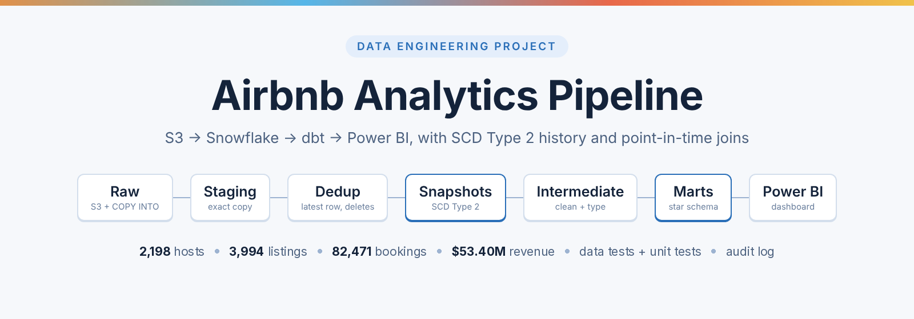
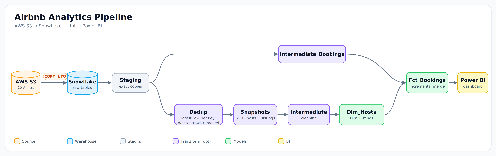
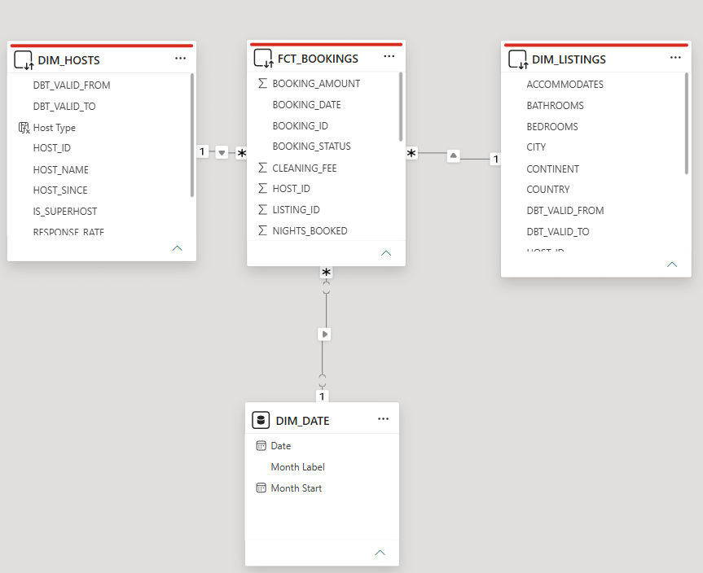
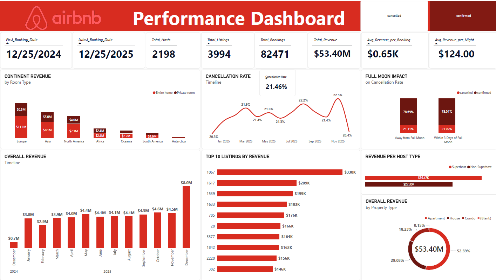
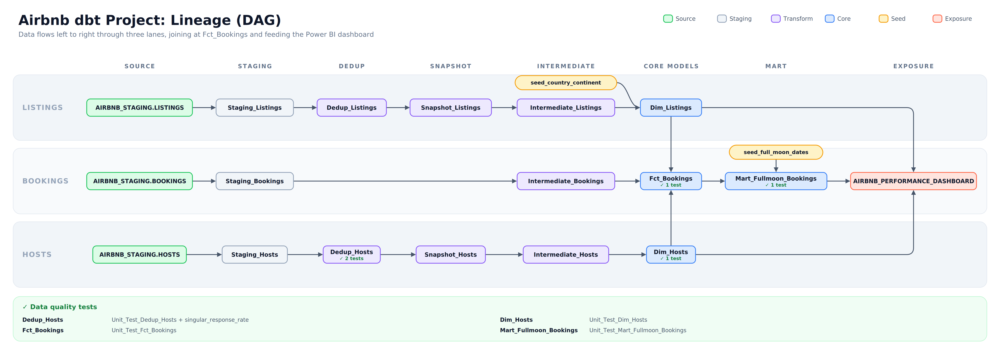
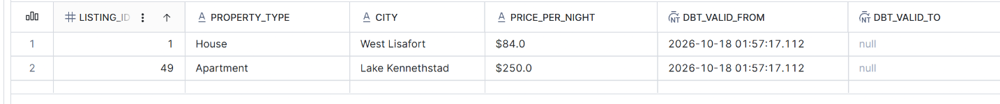
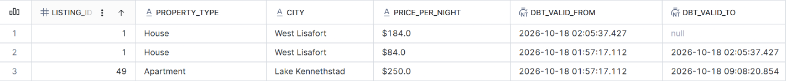

# Airbnb Analytics Pipeline: S3 → Snowflake → dbt → Power BI

An end-to-end data engineering project. Airbnb-style booking data is loaded from S3 into Snowflake, modeled with dbt into a star schema (with SCD Type 2 history for hosts and listings, and a Type 1 current-state layer), and served to a Power BI dashboard.



## Highlights

- **SCD Type 1 and Type 2 side by side.** The Dedup models are the Type 1 (current state) layer. dbt snapshots on top of them give the Type 2 history for hosts and listings, built on raw (uncleaned) values so that changes in cleaning logic can never rewrite history.
- **Point-in-time joins:** each booking is linked to the host and listing versions that applied on its booking date.
- **Delete handling through S3:** a delete is a new row with the key and `TO_BE_DELETED = TRUE`. It flows through the dedupe layer and closes the record in the snapshot, so nothing is deleted by hand in Snowflake. Deleting a host cascades to its listings, but never to bookings.
- **Self-healing incremental fact:** `Fct_Bookings` re-reads bookings with missing dimension keys on every run, so late-arriving hosts and listings fix old bookings automatically. A full refresh is kept for key-changing events.
- **Layered, tested models:** data tests for quality and unit tests for the logic I wrote (dedupe and cascade, SCD2 dates, incremental merge, point-in-time join).
- **Least-privilege access:** separate roles for dbt (builds objects) and Power BI (read-only on the marts), with key-pair authentication for service users.
- **Documented lineage:** dbt docs and an exposure that connects the models to the dashboard.
- **Run audit log:** `on-run-start` and `on-run-end` hooks record the status, materialization type and execution time of every node in an audit table.

## Architecture



| Layer | Models | Purpose |
|---|---|---|
| Raw | `HOSTS`, `LISTINGS`, `BOOKINGS` | Tables loaded from S3 with `COPY INTO`. `LOADED_AT` defaults to the load time |
| Staging | `Staging_Hosts`, `Staging_Listings`, `Staging_Bookings` | Exact copy of the raw data, nothing changed |
| Dedup | `Dedup_Hosts`, `Dedup_Listings` | **SCD Type 1.** Latest row per key, removal of rows flagged `TO_BE_DELETED`, and for listings the removal of listings whose host is no longer present |
| Snapshots | `Snapshot_Hosts`, `Snapshot_Listings` | **SCD Type 2** history (timestamp strategy on `LOADED_AT`, `hard_deletes: invalidate`) |
| Intermediate | `Intermediate_Hosts`, `Intermediate_Listings`, `Intermediate_Bookings` | Cleaning and typing |
| Marts | `Dim_Hosts`, `Dim_Listings`, `Fct_Bookings`, `Mart_Fullmoon_Bookings` | Star schema and analysis tables for reporting |
| Seeds | `seed_full_moon_dates`, `seed_country_continent` | Reference data (full moon dates, country-to-continent mapping) |
| Miscellaneous | `Mart_Fullmoon_Bookings` | Combines `Fct_Bookings` and the full moon dates to see the impact of the full moon on cancellation |

## Data model



A star schema with `Fct_Bookings` at the center.

- **`Fct_Bookings`:** one row per booking. Holds the measures (`NIGHTS_BOOKED`, `BOOKING_AMOUNT`, `CLEANING_FEE`, `SERVICE_FEE`), the booking status, and the surrogate keys of the listing and host versions that applied on the booking date.
- **`Dim_Hosts`:** one row per host *version* (`SURROGATE_HOST_ID`), with `DBT_VALID_FROM`, `DBT_VALID_TO` and `IS_CURRENT`.
- **`Dim_Listings`:** one row per listing version, with the same validity columns and the continent from the country mapping seed.
- **`Dim_Date`:** one row per date, including the `month_start` date for each date (created inside Power BI).

The fact table finds the right versions of dimensions by first finding the time period in which the booking took place. Bookings carry only a listing ID, so the listing version comes first and the host version follows from it:

```sql
left join Dim_Listings l
 on  b.LISTING_ID   = l.LISTING_ID
 and b.BOOKING_DATE >= l.DBT_VALID_FROM
 and b.BOOKING_DATE <  l.DBT_VALID_TO
left join Dim_Hosts h
 on  l.HOST_ID      = h.HOST_ID
 and b.BOOKING_DATE >= h.DBT_VALID_FROM
 and b.BOOKING_DATE <  h.DBT_VALID_TO
```

## Design decisions

**1. Dedupe is its own layer.** Staging stays an exact copy of Snowflake. Dedup picks the latest row per key by `LOADED_AT` and removes deleted rows. The snapshot therefore always reads one raw row per key.

**2. Explicit delete flag.** A delete is a row with the key and `TO_BE_DELETED = TRUE`. In the Dedup models, the latest row per key is picked first and only then filtered with `COALESCE(TO_BE_DELETED, FALSE) = FALSE`. The order matters: filtering first would let an older, non-deleted row win over the delete row and bring the key back. A deleted key disappears from the snapshot's input, and `hard_deletes: invalidate` closes its current version. Re-inserting the key later with a newer `LOADED_AT` brings it back as a new version.

- **Deletes cascade from hosts to listings, and stop there.**

| Relationship | Cascade? | Why |
|---|---|---|
| Host → Listings | Yes | A listing without a host is an orphan. `Dedup_Listings` keeps only listings whose `HOST_ID` exists in `Dedup_Hosts`, so the snapshot closes them too |
| Listing → Bookings | No | `Fct_Bookings` is a record of events that happened. Deleting a listing must not delete its past bookings. A fact table only grows, and one that loses rows loses history |

The cascade is applied in the shared `dedup_and_deletion` macro. Dedup for hosts runs two steps (latest row per key, then the flag filter). Dedup for listings runs a third one, `HOST_ID IN (SELECT HOST_ID FROM Dedup_Hosts)`. Because the cascade is computed from the current state of `Dedup_Hosts`, it is reversible: if the host returns, its listings return, unless their own latest row is flagged for deletion.

Bookings of a deleted listing keep their history through the point-in-time join. A booking dated before the listing was closed still matches the closed version. A booking dated after the closing date matches no version and is stored with null keys (see decision 5).

**3. Snapshots are taken after deduping and before any cleaning.** The order matters in both directions. *After* deduping, because a snapshot needs exactly one row per key, and duplicates would cause merge errors or two current rows. *Before* cleaning, because of changes like a raw price `'$10'` becoming `10`. If the snapshot stores cleaned values, a later change to the cleaning logic looks the same as a change in the data. With the `check` strategy, every row would appear changed, so each record would be closed and reopened even though the source didn't change. With either strategy, the stored history keeps the values produced by the old logic, and a snapshot can't be rebuilt from the source, so it can't be re-cleaned. Snapshotting raw values avoids both problems: the cleaning runs downstream and is reapplied to every historical version.

**4. Two sentinel dates make the join work.** Snapshot dates record when the pipeline loaded a version, not when it began in the real world, so bookings can predate a key's first version. The earliest version of each key is set to start at `1900-01-01`. The current version's `DBT_VALID_TO` (null in the snapshot) is set to `9999-12-31 23:59:59`, because a comparison with null never succeeds in a join.

**5. Incremental fact table.** `Fct_Bookings` loads bookings in two groups on every run, combined with `OR`, and merges them on `unique_key = BOOKING_ID`:

1. **New bookings:** `BOOKING_LOADED_AT >= (select max(BOOKING_LOADED_AT) from {{ this }})`. Rows loaded at the latest timestamp are read again, which is safe because the merge on `BOOKING_ID` gives the same result.
2. **Unresolved bookings:** bookings already in the fact whose `SURROGATE_LISTING_ID` or `SURROGATE_HOST_ID` is null. These are read again on every run.

```sql

where b.BOOKING_LOADED_AT >= (select max(BOOKING_LOADED_AT) from {{ this }})
   or b.BOOKING_ID in (
        select BOOKING_ID
        from {{ this }}
        where SURROGATE_LISTING_ID is null
           or SURROGATE_HOST_ID is null
   )

```

The second logic handles **dimensions arriving post the booking data**. If a booking is loaded before its listing or host exists in `Dim_Listings` or `Dim_Hosts`, the join returns null keys. When the listing or host arrives later, its first version starts at `1900-01-01`, so the old booking's date falls inside it and the next run fills in the keys. Even with foreign keys in the source system, this can happen: Snowflake does not enforce foreign keys on standard tables, files for bookings and listings can be loaded in different runs, and deletes (including the host-to-listing cascade) can remove a parent after the booking was made.

There are two ways to fix null keys, and they are used for different jobs:

| | Retry condition (every run) | `--full-refresh` |
|---|---|---|
| Cost | Depends on the number of unresolved bookings | Depends on the size of the table |
| Repairs | Null keys only | Every key, including outdated ones |
| Trigger | Automatic | Manual |
| Use for | Routine late arrivals | Rebuilt snapshots, changed surrogate key logic, fixed join logic |

Rebuilding the snapshots changes the surrogate keys, so the fact needs a full refresh afterwards (`dbt build --full-refresh --select Fct_Bookings`).

Some unresolved bookings never resolve: their listing was never loaded, or they are dated after their listing was closed by a delete. These are read again on every run. That is harmless at this size, and the Limitations section describes how to handle it at scale.

**6. Access is least-privilege.** `ROLE_DBT` creates and owns the dbt objects. `Role_PowerBI` has usage on the warehouse, database and schemas, and receives `SELECT` on each reporting model through a post-hook (see Macros and hooks). Service users authenticate with key pairs.

**7. Dbt source freshness && dbt build.** Source freshness is checked before each build (warn after 3 days, error after 5; an error blocks the build).

## Slowly changing dimensions: Type 1 and Type 2

The project keeps both versions of each dimension. They answer different questions.

| | Type 1 (Dedup models) | Type 2 (Snapshots) |
|---|---|---|
| Rows per key | One, the latest | One per version |
| History | Overwritten | Kept with `DBT_VALID_FROM` / `DBT_VALID_TO` |
| Deleted keys | Removed | Last version closed, kept |
| Used for | Current-state reporting | Point-in-time joins in `Fct_Bookings` |

**How to create a Type 1 dimension.** No snapshot is needed. A Type 1 dimension only keeps the current state of each key, which is exactly what the Dedup models produce:

1. Take the latest row per key from Staging, ordered by `LOADED_AT` descending (`ROW_NUMBER() ... = 1`). A changed attribute replaces the old value, so the old value is not visible in this layer.
2. Filter out the keys whose latest row has `TO_BE_DELETED = TRUE`. Deleted keys simply disappear.
3. For listings, also filter out listings whose host is no longer in `Dedup_Hosts` (the cascade).

That is all. The result has one row per `HOST_ID` or `LISTING_ID`. If a Type 1 star schema is wanted, apply the Intermediate cleaning on top of the Dedup models and join facts on the natural key, which is safe because each key has exactly one row.

```sql
-- Dedup_Hosts.sql
{{ dedup_and_deletion('Staging_Hosts', 'HOST_ID', 'LOADED_AT', 'TO_BE_DELETED') }}

-- Dedup_Listings.sql
{{ dedup_and_deletion('Staging_Listings', 'LISTING_ID', 'LOADED_AT', 'TO_BE_DELETED') }}
```

**Type 1 is not a point-in-time model.** A booking from last March joins to the host's current values, not the values on its booking date, and bookings of deleted keys find no row. The Staging and raw tables still hold every old row, so the history can be recomputed, but it is not exposed in the Type 1 layer. For point-in-time reporting, `Fct_Bookings` uses the Type 2 dimensions.

**How the Type 2 dimension is created.** The snapshots read the Dedup models (one clean row per key), keep every version, and close a version when its key changes or disappears. The `scd2_dbt_valid_from` and `scd2_dbt_valid_to` macros then add the sentinel dates in the dimensions (decision 4).

## Why `LOADED_AT` matters

`LOADED_AT` is not in the S3 files. It is a column in the raw tables that defaults to Snowflake's current timestamp when a file is loaded. The same column drives three separate mechanisms, so it works as the pipeline's version clock:

| Where | How `LOADED_AT` is used |
|---|---|
| `Dedup` | `ROW_NUMBER() OVER (PARTITION BY key ORDER BY LOADED_AT DESC)` keeps the latest row per key. A later delete row beats an earlier real row, which is how deletes take effect |
| `Snapshots` | `strategy: timestamp` with `updated_at: LOADED_AT`. A row with a newer `LOADED_AT` than the stored version closes that version and opens a new one, and `DBT_VALID_FROM` and `DBT_VALID_TO` come from it |
| `Fct_Bookings` | The incremental filter `BOOKING_LOADED_AT >= (select max(BOOKING_LOADED_AT) from {{ this }})` picks up new or changed bookings. Rows loaded at the latest timestamp are read again, which is safe because the merge on the booking key gives the same result |

Because everything depends on one column, a few rules follow:

- **It is system time, not event time.** It records when the data was loaded, not when it became true. That is why bookings can predate a key's first version, and why the sentinel dates exist. It is also why a deleted key's closing date in the snapshot is the time of the run that processed the delete.
- **Load each file once, in chronological order.** Reloading the same file gives its rows a newer `LOADED_AT`, which creates a new snapshot version even though nothing changed. Loading an older file after a newer one makes the old data look like the latest.
- **Never edit or backfill `LOADED_AT` by hand.** Dedupe, history and the incremental load would all shift with it.

## Data quality and testing

**Data tests:** `unique` and `not_null` on keys at the Dedup layer, snapshot integrity (one current row per key), `accepted_values`, `relationships` between layers (set to `warn`), a custom generic test (`checking_negative`) and a singular test for the 0–100 range of `response_rate`. Because deletes cascade from hosts to listings, `Dedup_Listings.HOST_ID` → `Dedup_Hosts.HOST_ID` passes by construction, and the test protects against the cascade being broken later.

**`dbt_utils.generate_surrogate_key`:** creates a surrogate key from the provided columns (here, the business ID plus `DBT_VALID_FROM`). Snapshots keep several versions of the same host or listing, so `HOST_ID` and `LISTING_ID` no longer identify a row uniquely on their own.

**`dbt_expectations` row-count check:** `expect_table_row_count_to_equal_other_table` compares the number of rows in two models that should match. It caught the duplicate rows described under *Reference data*.

**Unit tests** cover the logic that was written by hand, with small mock datasets. Fixtures include the `TO_BE_DELETED` column, and inputs that are ephemeral models use `format: sql`.

| Unit test | What it proves |
|---|---|
| `Unit_Test_Dedup_Hosts` | Latest row wins, rows flagged `TO_BE_DELETED` are dropped (even when an older row for the key is not flagged), a re-inserted key returns |
| `Unit_Test_Dedup_Listings` | Latest row wins, flagged listings are dropped, listings of an active host are kept, listings of a deleted or non-existent host are dropped, a deleted then re-inserted listing returns |
| `Unit_Test_Dim_Hosts` | First version starts at 1900, the current version ends at 9999 |
| `Unit_Test_Fct_Bookings` | Bookings match the right listing and host versions. The incremental logic picks up bookings loaded at or after the latest `BOOKING_LOADED_AT` already in the fact, and also re-reads bookings whose surrogate listing or host key is still null. A booking whose listing is not in `Dim_Listings` keeps null keys, and is picked up again on later runs so it gets its keys once the listing exists |
| `Unit_Test_Mart_Fullmoon_Bookings` | The joining condition between booking and full moon seed was that the booking should be +/- 3 days of the full moon date |

## Macros and hooks

| Macro | Purpose |
|---|---|
| `generate_schema_name` | Overrides dbt's schema naming so each model lands in exactly the schema configured for it |
| `dedup_and_deletion` | Shared Type 1 logic: latest row per key by `LOADED_AT`, removal of rows flagged `TO_BE_DELETED`, and for listings the host cascade. Used by the Dedup models |
| `audit_log` | Writes one row per node of every run into the audit table (see below). Defined in `Filling_Audit_Log.sql` |
| `scd2_dbt_valid_from` | Sets the start of each key's earliest version to `1900-01-01`, so bookings that predate the first snapshot still match |
| `scd2_dbt_valid_to` | Replaces the null end date of the current version with `9999-12-31 23:59:59`, so the date-range join works |

**`dedup_and_deletion`** The macro runs the same steps for hosts and listings. The third condition, the host cascade, applies only when the source model is `Staging_Listings`:

```sql

with CTE_Ranked as (
    SELECT
        *,
        ROW_NUMBER() OVER (PARTITION BY {{key_column}} ORDER BY {{order_by_column}} DESC) as rn
    FROM    
        {{ref(ref_model)}}
)

SELECT
    *
FROM 
    CTE_Ranked 
WHERE 
    rn = 1
AND 
    coalesce({{deletion_flag}}, FALSE) = FALSE

AND 
    HOST_ID in (SELECT distinct HOST_ID from {{ref('Dedup_Hosts')}})


```

The latest row is picked first and only then filtered, so a delete row beats an older real row. Listings with a null `HOST_ID` never match the `IN` and are dropped.

**Custom `generate_schema_name`.** By default, dbt builds a schema name by joining the target schema and the custom schema, for example `STAGING_MARTS`. The override changes this: if a model, snapshot or seed sets a custom schema, that name is used exactly as written, and otherwise the target schema is used. Objects therefore land in `INTERMEDIATE`, `MARTS` and `SNAPSHOTS` with clean names, which also keeps the grants for Power BI simple.

```sql

    
        {{ target.schema }}
    
        {{ custom_schema_name | trim }}
    

```

**Audit log.** Two hooks and one macro record every dbt run in `AIRBNB_PROJECT.AUDIT.AUDIT_LOG`:

- `on-run-start` creates the `AUDIT` schema and the log table if they do not exist.
- `on-run-end` calls the `audit_log` macro. dbt passes it the run results, a list with one entry per node that ran, and the macro writes one row per node with a single `INSERT`.

| Column | Meaning |
|---|---|
| `MODEL_NAME` | Name of the node |
| `MATERIALIZATION_TYPE` | view, table, incremental, snapshot, seed and so on |
| `STATUS` | success, error or skipped |
| `EXECUTION_TIME` | Seconds the node took to run |
| `MATERIALIZATION_TIMESTAMP` | When the row was written (the batch timestamp) |
| `BATCH_ID` | dbt's invocation ID, identical for every row of one run |

The end hook runs even when a node fails, so failed and skipped nodes are logged too. Filtering by `BATCH_ID` shows a single run, and `STATUS` and `EXECUTION_TIME` make failures and slow models easy to find.

```sql
select * from AIRBNB_PROJECT.AUDIT.AUDIT_LOG order by MATERIALIZATION_TIMESTAMP desc;
```

**Granting access to Power BI.** A post-hook, configured in `dbt_project.yml`, runs after each model in the marts and miscellaneous folders is built and grants `SELECT` on it to `Role_PowerBI`. This is needed because dbt rebuilds table and view models with `CREATE OR REPLACE`, which does not keep the privileges of the old object, so the grant has to be applied again on every build. The result is that Power BI can read the reporting models and nothing else, nobody has to grant access by hand, and a new model placed in those folders is available to the dashboard automatically.

## Dashboard



Observations on this sample dataset (2.2K hosts, 4.0K listings, 82.5K bookings, about $53.40M revenue, 25 Dec 2024 to 25 Dec 2025):

- The overall cancellation rate is 21.46%. The monthly rate stays in a narrow band between 20.3% and 22.5%, with no clear trend.
- Cancellations are 21.31% away from full moons and 21.99% within 3 days of one. A difference of about 0.7 points is not a meaningful effect on this data.
- Superhosts earn more than non-superhosts: $36.47K versus $27.30K per host, roughly a third higher.
- Monthly revenue is steady at about $3.8M to $4.6M from January to November 2025. February is lower ($2.9M) because it is a shorter month. December 2025 spikes to $8.0M, about double a typical month, and is worth checking for seasonality or a data artifact. December 2024 ($0.7M) is a partial month because the data starts on 25 Dec.
- Apartments contribute 52.59% of revenue, houses 29.03% and condos 18.23%. About 0.15% has no property type.
- Europe, Asia and North America bring in about $41.8M, roughly 78% of revenue. Entire homes out-earn private rooms in each of them.
- Revenue is not concentrated in a few listings. The top 10 listings ($146K to $330K each) add up to about $1.89M, around 3.5% of the total.

## Lineage Graph



## Repository structure

```
AIRBNB_PROJECT/
├── dbt_project.yml
├── packages.yml
├── package-lock.yml
├── README.md
├── docs/
│   └── images/
│       ├── Architecture.png
│       ├── DAG.png
│       ├── Dashboard.png
│       ├── Data_Model.png
│       ├── Snapshot_post_updating_Listing.png
│       └── Snapshot_pre_updating_Listing.png
├── macros/
│   ├── dedup_and_deletion.sql
│   ├── scd2_dbt_valid_from.sql
│   ├── scd2_dbt_valid_to.sql
│   ├── Filling_Audit_Log.sql
│   └── generate_schema_name.sql
├── models/
│   ├── 01_Staging/              # exact copies of the raw tables
│   │   ├── Staging_Hosts.sql
│   │   ├── Staging_Listings.sql
│   │   └── Staging_Bookings.sql
│   ├── 02_Dedup/                # SCD1: latest row per key, deleted rows removed, host cascade
│   │   ├── Dedup_Hosts.sql
│   │   └── Dedup_Listings.sql
│   ├── 03_Intermediate/         # cleaning and typing
│   │   ├── Intermediate_Hosts.sql
│   │   ├── Intermediate_Listings.sql
│   │   └── Intermediate_Bookings.sql
│   ├── 04_Marts/                # star schema for reporting
│   │   ├── Dim_Hosts.sql
│   │   ├── Dim_Listings.sql
│   │   └── Fct_Bookings.sql
│   ├── 05_Miscellaneous/        # extra analysis tables
│   │   └── Mart_Fullmoon_Bookings.sql
│   ├── source.yml               # raw table definitions
│   ├── schema.yml               # tests and column docs
│   ├── exposures.yml            # links the models to the Power BI dashboard
│   └── Docs.md                  # dbt docs blocks
├── seeds/
│   ├── seed_country_continent.csv
│   ├── seed_full_moon_dates.csv
│   └── seeds.yml
├── snapshots/
│   └── snapshot.yml
└── tests/
    ├── generic/
    │   └── checking_negative.sql
    └── singular_response_rate.sql
```

`profiles.yml` is kept outside the repository, and `dbt_packages/` is generated by `dbt deps`.

## Connecting dbt and Power BI to Snowflake (key-pair authentication)

The dbt and Power BI service users sign in with an RSA key pair instead of a password. Snowflake stores only the **public** key on the user. The **private** key stays with the client (dbt or Power BI), so no password is stored or sent.

**1. Generate the key pair with OpenSSL** (one pair per user, kept outside the repository):

```bash
# encrypted private key (PKCS#8), protected by a passphrase
openssl genrsa 2048 | openssl pkcs8 -topk8 -v2 aes256 -inform PEM -out rsa_key.p8

# matching public key
openssl rsa -in rsa_key.p8 -pubout -out rsa_key.pub
```

**2. Register the public key on the Snowflake user.** Paste the key text without the `-----BEGIN PUBLIC KEY-----` and `-----END PUBLIC KEY-----` lines:

```sql
CREATE USER IF NOT EXISTS USER_DBT
    LOGIN_NAME = 'USER_DBT'
    TYPE = SERVICE
    RSA_PUBLIC_KEY = '...';
```

**3. Give the private key to the client.**

**dbt:** `private_key_path` and `private_key_passphrase` in `profiles.yml` (see Getting started)

- **Step 1: Create the variable (Windows).** Run `setx` once in the VS Code terminal (PowerShell):

```powershell
setx SNOWFLAKE_PRIVATE_KEY_PASSPHRASE "your-passphrase"
```

- **Step 2: Restart so the terminal sees it.** `setx` doesn't change the terminal you're typing in. Close the terminal, then close VS Code completely and reopen it.

- **Step 3: Reference it in `profiles.yml`:**

```yaml
private_key_passphrase: "{{ env_var('SNOWFLAKE_PRIVATE_KEY_PASSPHRASE') }}"
```

**Power BI:** 

- In the Snowflake sign-in dialog, enter the username, paste the contents of the private key file and enter the passphrase. The role (`Role_PowerBI`) goes in the connector's advanced options.

**Security notes**

- Never commit the private key, the passphrase or `profiles.yml`.
- The two tools use separate users and roles: `USER_DBT` / `ROLE_DBT` builds the objects, and `USER_POWERBI` / `Role_PowerBI` is read-only on the marts.

## Getting started

**Prerequisites:** a Snowflake account, an S3 bucket with the CSV files, Python 3.9+ with `dbt-snowflake`, `dbt-core`, `dbt-autofix` and `snowflake-connector-python`, and Power BI Desktop (for the dashboard).

1. **Snowflake setup.** Create the warehouse, database, storage integration, stages, file format and raw tables. The `TO_BE_DELETED` column must be a boolean (`TRUE`/`FALSE`) in the raw `HOSTS` and `LISTINGS` tables, because the Dedup models compare it with `FALSE`. Then create the roles and users (`ROLE_DBT`, `Role_PowerBI`) and grant access. Use `CREATE ROLE IF NOT EXISTS`, never `CREATE OR REPLACE ROLE` (see Lessons learned). If your Snowflake account is in an AWS region that is disabled by default, enable that region and its STS endpoint in the AWS account first, or the storage integration fails with an `AssumeRole` error.

2. **Load the data.** Upload the files to S3 and run `First_Data_Engineering_Project.sql`, in which `COPY INTO` uses a file-name pattern so that only the matching files are loaded:

   | Table | Pattern |
   |---|---|
   | `LISTINGS` | `^Listings.*[.]csv` |
   | `HOSTS` | `^Hosts.*[.]csv` |
   | `BOOKINGS` | `^Bookings.*[.]csv` |

3. **Configure dbt.** Add a `profiles.yml` outside the repository, for example:

   ```yaml
   AIRBNB_PROJECT:
     target: dev
     outputs:
       dev:
         type: snowflake
         account: <account_identifier>
         user: USER_DBT
         private_key_path: "{{ env_var('SNOWFLAKE_PRIVATE_KEY_PATH') }}"
         private_key_passphrase: "{{ env_var('SNOWFLAKE_PRIVATE_KEY_PASSPHRASE') }}"
         role: ROLE_DBT
         warehouse: ELT_WH
         database: AIRBNB_PROJECT
         schema: STAGING
         threads: 1
   ```

   Set `SNOWFLAKE_PRIVATE_KEY_PATH` and `SNOWFLAKE_PRIVATE_KEY_PASSPHRASE` in your terminal first (see *Connecting dbt and Power BI to Snowflake*).

4. **Install packages and build.**

   ```bash
   dbt deps
   dbt build
   ```

   On the first run on an empty warehouse, the incremental unit test needs the target table to exist. Run `dbt build --exclude-resource-type unit_test` first, then a normal `dbt build`.

5. **Browse the docs.**

   ```bash
   dbt docs generate
   dbt docs serve
   ```

## Demo: inserts, updates and deletes

1. Run `dbt build` on the initial files.
2. **Update:** upload a new file with a changed value for an existing host or listing (use a new file name, because Snowflake skips file names it has already loaded), run `COPY INTO`, then `dbt build`.
3. **Delete a listing:** upload a file with the listing's key and `TO_BE_DELETED = TRUE`, run `COPY INTO`, then `dbt build`.
   **Delete a host:** do the same for a host. All of its listings also close in the snapshot, while its bookings stay in `Fct_Bookings`.
4. Inspect the history:

   ```sql
   select listing_id, dbt_valid_from, dbt_valid_to
   from AIRBNB_PROJECT.SNAPSHOTS.SNAPSHOT_LISTINGS
   where listing_id = <id>
   order by dbt_valid_from desc;
   ```

   The updated key shows a closed version and a new current one. The deleted key shows a closed last version and no current row, and so do the listings of a deleted host. The closing date is the time of the run that processed the delete, not the time of the change in the source.

**Before the update:**



**After the update:**



## Reference data: country-to-continent mapping

The continent breakdown on the dashboard comes from a country-to-continent mapping file loaded as a dbt seed (`seed_country_continent`) and joined to the listings. Joining on names raised two problems:

1. **Names didn't match.** Country names in the listings data didn't always match the spelling in the downloaded mapping file, so some listings found no continent. I corrected the names in the mapping file by hand.
2. **Transcontinental countries created duplicate rows.** A country such as Turkey can appear under two continents, so joining listings to the mapping returned more than one row per listing, and the duplicates carried into the downstream models. A `dbt_expectations` row-count test (`expect_table_row_count_to_equal_other_table`) between the two models caught the extra rows, and the fix was to keep a single continent per country in the mapping.

The lesson: a mapping table used in a join must be unique on its join key. Treat it like any other dimension and test it.

## Lessons learned

- **An `AssumeRole` error can be caused by the region, not the IAM role.** The storage integration failed with "is not authorized to perform: sts:AssumeRole" even though the trust policy, external ID and role ARN were all correct. The cause was that my Snowflake account runs in `ap-southeast-7` (Thailand), an AWS region that is disabled by default. Snowflake assumes the role through the STS endpoint of its own region, so that region had to be enabled in the AWS account (Account > AWS Regions) and its STS endpoint activated (IAM > Account settings > Security Token Service). The S3 bucket, in a different region, did not need to move, because Snowflake can read across regions.
- **Key-pair authentication keeps passwords out of the pipeline.** I generated the key pair with OpenSSL. Snowflake holds only the public key on the service user, and the private key stays with dbt and Power BI. See *Connecting dbt and Power BI to Snowflake*.
- **Ownership in Snowflake.** `CREATE OR REPLACE ROLE` drops the role, and ownership of its objects passes to the role that ran the drop. The recreated role has the same name but can't replace the old views, because `GRANT ALL` never includes `OWNERSHIP`. Instead, use `CREATE <object> IF NOT EXISTS <name>` so that the object is only created once.
- **Import vs DirectQuery in Power BI.** Power BI can get data from Snowflake in two ways. `Import` copies the data into the Power BI model, so it behaves like a batch load: it is fast, but it changes only when the dataset is refreshed, so the refresh has to be scheduled after *dbt build*. `DirectQuery` leaves the data in Snowflake and sends a query on every filter, slicer or page load, so it is always current but slower and costs warehouse compute on each interaction. *For e.g*. deleted hosts and listings only disappear from the dashboard after the next refresh (Import) or immediately (DirectQuery).
- **A historized dimension needs surrogate keys.** Joining on the natural key would match every version and multiply the bookings.
- **Foreign keys in Snowflake are informational.** Standard tables do not enforce them, so orphans can still arrive. The incremental fact is written to survive that.

## Limitations and next steps

- **Country matching is by name.** A country spelled differently from the mapping file gets no continent, so new data needs a mapping check.
- **Unresolved bookings are retried forever.** Bookings of a deleted listing, dated after it was closed, keep null keys and are read again on every run. That is harmless at this size, but at scale the fix is an "unknown" member (a fixed surrogate key such as `-1`) in `Dim_Hosts` and `Dim_Listings`, so unresolved bookings get a real key and the retry only covers true late arrivals. Alternatively, we can rely on `--full-refresh`.
- **Orchestration is manual.** The pipeline is run with the commands above. The next step is an Airflow DAG for load, snapshot and build, source freshness checks and alerting.
- **CI:** a GitHub Action that runs `dbt build` on pull requests.
